# Site Engineer App — Screen Flowchart

This is a sitemap of every real screen file under `app/` in this Expo Router app,
and the actual navigation edges between them, built by reading the current code
(routing layouts, `DrawerContent.tsx`'s role-gating sets, every screen's own
in-screen role checks, and every `router.push`/`router.replace`/`navigation.navigate`
call found in `app/`, `components/`, and `lib/`) rather than assumed from file names.

Two screens exist purely as role variants rendered by `app/(authenticated)/home.tsx`
(`AppHome` for staff, `ClientHome` for clients) rather than as separate route files,
so they're drawn as one **Home** node whose outbound links differ by role (labeled
accordingly). Everything else below is a real, separately-routable file.

## Diagram

```mermaid
flowchart TD
    classDef staffWide fill:#DCFCE7,stroke:#16A34A,color:#14532D
    classDef adminManager fill:#DBEAFE,stroke:#2563EB,color:#1E3A8A
    classDef adminOnly fill:#FEF3C7,stroke:#D97706,color:#78350F
    classDef fieldOnly fill:#FCE7F3,stroke:#DB2777,color:#831843
    classDef everyone fill:#F3F4F6,stroke:#6B7280,color:#1F2937
    classDef orphan fill:#FEE2E2,stroke:#DC2626,color:#7F1D1D,stroke-dasharray: 4 3

    %% ---------- Auth & Onboarding ----------
    subgraph AUTH["Auth & Onboarding"]
        Opening["/ (index.tsx)<br/>Opening Screen"]:::everyone
        Login["login.tsx<br/>Login"]:::everyone
    end

    %% ---------- Home & Navigation ----------
    subgraph HOMENAV["Home & Navigation"]
        Home["home.tsx<br/>Home (AppHome / ClientHome)"]:::everyone
        ProjDash["project-dashboard.tsx<br/>Project Dashboard"]:::staffWide
        TeamCat["team/[category].tsx<br/>Team Category"]:::staffWide
    end

    %% ---------- Tasks & Flowchart ----------
    subgraph TASKS["Tasks & Flowchart"]
        TaskList["task-list.tsx<br/>Task List"]:::orphan
        Flowchart["flowchart.tsx<br/>Flowchart"]:::everyone
        Gantt["gantt.tsx<br/>Gantt Chart"]:::everyone
        TaskDetail["task/[taskId].tsx<br/>Task Detail"]:::everyone
        ChecklistHub["checklist-templates.tsx<br/>Checklist Templates"]:::staffWide
        ChecklistType["checklist-templates/[type].tsx<br/>Checklist Template (ACC/ACV)"]:::staffWide
        TemplateKit["flowchart-templates.tsx<br/>Flowchart Template Kit"]:::staffWide
        TemplateApply["flowchart-templates/apply/[templateId].tsx<br/>Apply Template Wizard"]:::staffWide
        TemplateCanvas["flowchart-templates/canvas/[templateId].tsx<br/>Template Canvas"]:::staffWide
    end

    %% ---------- Critical Alerts, Notifications & Daily Updates ----------
    subgraph ALERTS["Critical Alerts, Notifications & Daily Updates"]
        CriticalAlerts["critical-alerts.tsx<br/>Critical Alerts"]:::staffWide
        Notifications["notifications.tsx<br/>Notifications"]:::adminManager
        DailyUpdates["daily-updates.tsx<br/>Daily Updates"]:::orphan
    end

    %% ---------- Attendance & Leave ----------
    subgraph ATTEND["Attendance & Leave"]
        Attendance["attendance.tsx<br/>Attendance (check-in/out)"]:::fieldOnly
        DayTimeline["day-timeline.tsx<br/>Day Timeline"]:::fieldOnly
        TeamAttendance["team-attendance.tsx<br/>Team Attendance"]:::adminManager
        TeamAttDetail["team-attendance-detail/[userId].tsx<br/>Engineer Attendance Detail"]:::adminManager
        LeaveLog["leave-log.tsx<br/>Leave Log"]:::adminManager
    end

    %% ---------- Admin: Access / Invoices / Settings ----------
    subgraph ADMIN["Admin — Access / Invoices / Settings"]
        AccessRoles["access-roles.tsx<br/>Access & Roles"]:::adminManager
        Invoices["invoices.tsx<br/>Invoices"]:::adminManager
        Settings["settings.tsx<br/>Settings"]:::adminManager
    end

    %% ---------- PMC Progress ----------
    subgraph PROGRESS["PMC Progress"]
        ProgressTracker["progress-tracker.tsx<br/>PMC Progress Tracker"]:::adminOnly
    end

    %% ---------- Reports ----------
    subgraph REPORTS["Reports"]
        ReportsHub["reports.tsx<br/>Reports Hub"]:::everyone
        TaskReport["reports/task-report.tsx<br/>Task Report"]:::everyone
        WeeklyReport["reports/weekly-report.tsx<br/>Weekly Report"]:::everyone
        MonthlyReport["reports/monthly-report.tsx<br/>Monthly Report"]:::everyone
        CustomReport["reports/custom-report.tsx<br/>Custom Date-Range Report"]:::everyone
        GeneralParamReport["reports/general-parameter-report.tsx<br/>General Parameter Report"]:::everyone
    end

    %% ---------- Debug (orphaned by design) ----------
    subgraph DEBUG["Debug (not linked from UI)"]
        DebugTracking["debug-test-tracking.tsx<br/>Debug Test Tracking"]:::orphan
    end

    %% ================= EDGES =================

    %% Auth / redirects
    Opening -.->|redirect: signed-in| Home
    Opening -.->|redirect: seen opening / continue tap| Login
    Login -.->|redirect: sign-in success| Home
    Home -.->|redirect: sign-out| Login
    ProjDash -.->|redirect: not signed in| Login
    ProjDash -.->|redirect: no project selected| Home
    TeamCat -.->|redirect: not signed in| Login
    TeamCat -.->|redirect: unknown category| Home
    TemplateApply -.->|redirect: apply complete| ProjDash

    %% Drawer-menu navigation (hamburger menu, available from any drawer screen)
    Home ==>|drawer menu| Notifications
    Home ==>|drawer menu| Attendance
    Home ==>|drawer menu| DayTimeline
    Home ==>|drawer menu| TeamAttendance
    Home ==>|drawer menu| LeaveLog
    Home ==>|drawer menu| AccessRoles
    Home ==>|drawer menu| Invoices
    Home ==>|drawer menu| Settings
    Home ==>|drawer menu, pinned above Menu, admin-only| ProgressTracker
    Home ==>|drawer: Projects folder| ProjDash
    Home ==>|drawer: Reports row| ReportsHub
    Home ==>|drawer: Reports row sub-items| TaskReport
    Home ==>|drawer: Reports row sub-items| WeeklyReport
    Home ==>|drawer: Reports row sub-items| MonthlyReport
    Home ==>|drawer: Reports row sub-items| CustomReport
    Home ==>|drawer: Reports row sub-items| GeneralParamReport
    Home ==>|drawer: Template Kit row next to Notifications| TemplateKit

    %% In-screen navigation: Home (AppHome, staff) quick links / cards
    Home -->|AppHome: tap project card| ProjDash
    Home -->|AppHome: tap Overview category row| TeamCat
    Home -->|AppHome: Quick Link| CriticalAlerts
    Home -->|AppHome: Quick Link| ChecklistHub

    %% In-screen navigation: Project Dashboard quick links
    ProjDash -->|back arrow| Home
    ProjDash -->|Quick Link| Gantt
    ProjDash -->|Quick Link| Flowchart
    ProjDash -->|Quick Link| CriticalAlerts
    ProjDash -->|Quick Link| TemplateKit
    ProjDash -->|Quick Link, field role| Attendance
    ProjDash -->|Quick Link, admin/manager| TeamAttendance
    ProjDash -->|Quick Link, admin/manager| Settings

    %% Team Category screen
    TeamCat -->|site-engineer category: tap engineer row| TeamAttDetail
    TeamCat -->|client category: report card| TaskReport
    TeamCat -->|client category: report card| WeeklyReport
    TeamCat -->|client category: report card| MonthlyReport

    %% Team Attendance
    TeamAttendance -->|tap engineer row| TeamAttDetail

    %% Tasks & Flowchart
    Flowchart -->|tap task node| TaskDetail
    Flowchart -->|empty state: Go to Home| Home
    Gantt -->|empty state: Go to Home| Home
    TaskList -->|tap task row| TaskDetail
    TaskDetail -->|tap dependency chip| TaskDetail
    ChecklistHub -->|tap AC/AV card| ChecklistType
    TemplateKit -->|create / Open action| TemplateCanvas
    TemplateKit -->|Edit action| TemplateApply

    %% Reports hub
    ReportsHub -->|report card| TaskReport
    ReportsHub -->|report card| WeeklyReport
    ReportsHub -->|report card| MonthlyReport
```

## Legend

**Node color = role gate** (checked against each screen's own code, not just
`DrawerContent.tsx`'s filter sets):

| Style | Meaning |
|---|---|
| Grey | Reachable by every signed-in role (client and all staff roles) |
| Green | Staff-wide (any non-client role: admin, manager, senior_site_engineer, site_engineer) |
| Blue | Admin or Manager only |
| Amber | Admin only (stricter than Admin/Manager) |
| Pink | Field role only (`site_engineer` / `senior_site_engineer`) |
| Red dashed | Orphaned — a real route file with no inbound navigation edge found anywhere in the app |

**Edge style = how the navigation actually happens:**

| Style | Meaning |
|---|---|
| `===>` thick arrow, "drawer menu" label | Navigating via the hamburger drawer (`navigation.navigate` in `components/DrawerContent.tsx`, or a `router.push` from inside the drawer panel itself, e.g. the Reports/Projects sub-rows and the Template Kit row) |
| `-->` solid arrow | In-screen navigation — tapping a card, quick-link, button, or list row inside a screen (`router.push`) |
| `-.->` dotted arrow | A `Redirect`, `router.replace`, or automatic role/state-based bounce, not a user-tapped link |

Notes on specific gates that don't map cleanly to a single filename:

- **Invoices** (`invoices.tsx`) actually allows both `isAdminOrManager` **and**
  `isClient` in its own in-screen check, but `DrawerContent.tsx`'s
  `ADMIN_MANAGER_ONLY_ROUTES` hides it from a client's menu, and no other screen
  ever links to it for a client. In practice it's admin/manager-only — colored
  blue here — but the client-facing code path is currently dead weight, not a
  live gap.
- **Gantt** and **Flowchart** render for any signed-in profile (not gated to
  staff internally beyond the empty-state copy/edit permissions), but the only
  way to reach either is Project Dashboard's quick links, and Project Dashboard
  itself is only reachable via a staff-only path (AppHome's project cards or the
  drawer's Projects folder — a client never sees either). So both are
  staff-wide in practice, colored green.
- **home.tsx** is colored grey since every role lands there, even though its
  *content* (`AppHome` vs `ClientHome`) and therefore its outbound edges differ
  sharply by role — see the edge labels.
- **Notifications** has a second, un-diagrammed entry point beyond the drawer
  row shown here: `components/NotificationBell.tsx` renders a bell icon in
  `headerRight` on **every** drawer screen (registered once in
  `app/(authenticated)/_layout.tsx`'s shared `screenOptions`) and pushes to
  `/notifications` on tap, for admin/manager only. Drawing that as one edge per
  drawer screen would just clutter the diagram with parallel lines to the same
  target already reachable from the drawer menu, so it's called out here
  instead of drawn.

## Orphaned / unreachable screens

Three real screen files have **zero inbound navigation edges** anywhere in the
codebase (no drawer row, no `router.push`/`navigation.navigate`/`<Link>` from
any other file):

1. **`app/(authenticated)/task-list.tsx`** — a registered `Drawer.Screen`
   (`app/(authenticated)/_layout.tsx`), but its name is in `DrawerContent.tsx`'s
   `HIDDEN_ROUTES` set, and no other screen or component anywhere pushes to
   `/task-list`. Unlike `critical-alerts` (also hidden from the drawer but
   reachable via Quick Links on Home and Project Dashboard), nothing replaces
   the drawer entry for Task List. This looks like a missing-nav-link bug: the
   screen is fully built (search, status filters, pending-review queue) but
   currently has no way to open it from the UI.
2. **`app/(authenticated)/daily-updates.tsx`** — same situation: hidden from
   the drawer (`HIDDEN_ROUTES` and `STAFF_ONLY_ROUTES`), fully implemented
   (slot-based DPR submission for field roles, project-wide review list for
   admin/manager), but no card, quick-link, or button anywhere in the app
   pushes to `/daily-updates`. Also looks like a missing-nav-link bug rather
   than intentional gating.
3. **`app/debug-test-tracking.tsx`** — orphaned *by design*, per its own header
   comment: a temporary standalone debug screen for a one-off tracking-reliability
   test on physical devices, deliberately not linked from anywhere (reachable
   only by typing the URL directly). Marked for deletion once that comparison
   is finished.

No other screen files were found without a real inbound edge — every other
route (including less-obvious ones like `reports/custom-report.tsx` and
`reports/general-parameter-report.tsx`, which are only reachable via the
drawer's expandable Reports sub-menu and not from the Reports hub screen
itself) has at least one traceable path to it from somewhere in the app.
